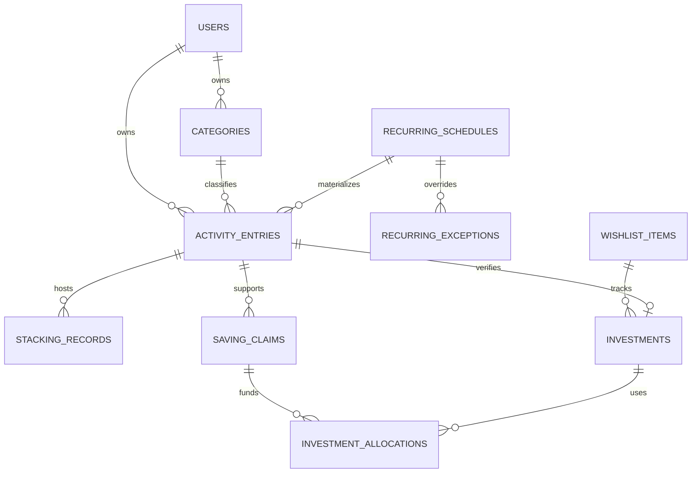

# 데이터베이스 설계

Phase 1은 users, categories, activity_entries를 생성한다. 활동의 계획·실제 구분은 종류 열로 관리하며 사용자/시작과 사용자/종료를 인덱싱한다. 카테고리 외래키에는 사용자 ID도 포함한다. 참조 중인 카테고리 삭제는 충돌로 처리한다. 모든 Phase 1 테이블에 생성·수정 시각을 둔다.

이후 단계에서 반복 규칙과 날짜 예외를 추가한다. 유일 키는 규칙 ID와 발생 날짜를 사용한다. 저장된 계획을 실제 활동으로 전환할 때 원본 발생 날짜를 참조한다. 절약 근거는 대체 대상 및 중첩 활동 구간을 참조하며 확보와 중첩 청구가 동일한 기준 시간을 공유한다. 재투자 배분은 확보 근거별 차감 내역을 저장한다. 목표별 태그를 여러 개 부여해도 실제 활동 ID는 한 번만 차감한다. 시나리오와 추천 설정은 사용자 범위로 관리하며 실제 원장과 분리한다.
